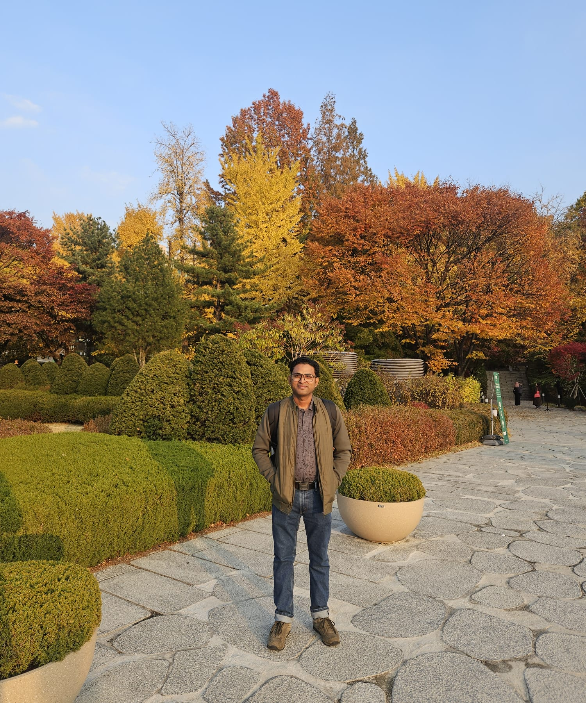

This week (Nov 9-13, 2026), I am visiting
[Ewha Womans University](https://www.ewha.ac.kr/ewhaen/index.do) in
Seoul. My host is Prof Chunglee Kim in the Astrophysics division of
the university. I am working on a project with Prof Kim and her
postdoc Dr Gwangeon Song, which we expect to complete within the next
few weeks. During my stay, we also plan to discuss new projects for
future collaboration.

During this visit, I am also delivering a series of introductory
lectures on the post-Newtonian formalism, which is used to derive
expressions for the gravitational waves emitted by compact binaries.

The university campus is beautiful. Located in central Seoul, the
university is easily accessible by bus and subway. For me, it is the
Line 2 subway, which takes about 30 minutes from my hotel near Guro
Digital Complex to Ewha Womans University station.

In previous years, I visited Seoul around mid-October. This time, it
is the second week of November, so I was not expecting to see the
autumn colors in all their glory. However, I was surprised to see
vivid colors throughout the university campus.

I am also enjoying the food. I have already tried grilled mackerel,
Korean BBQ, and bibimbap with steamed rice and abalone, and I plan to
enjoy samgyetang (which I like a lot) before I leave.

The weather is getting cold here, hovering around 5°C in the
morning. It rained a bit on Sunday, but since then it has been very
sunny and great for photography.

  

